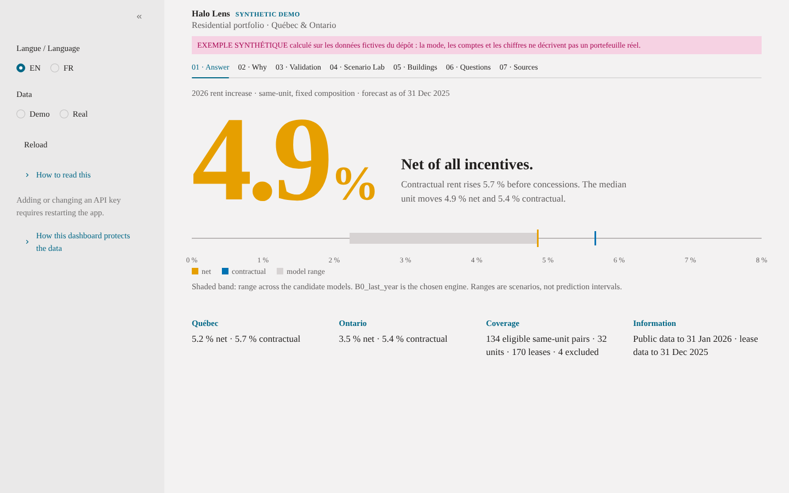
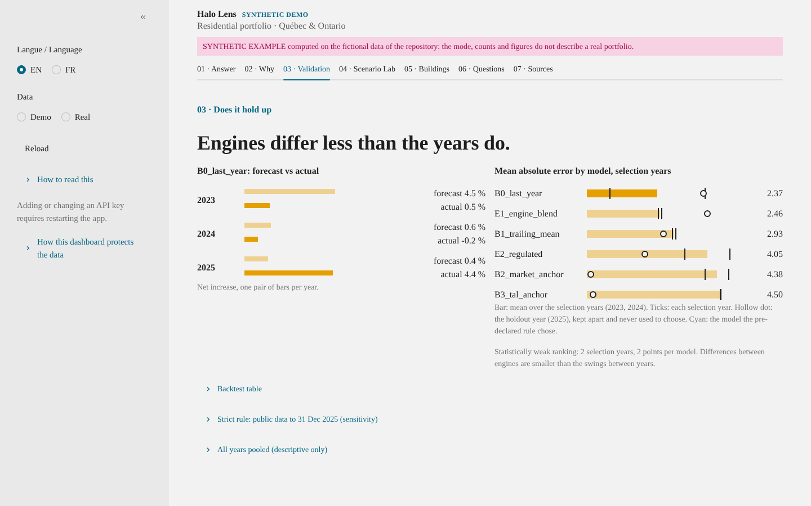
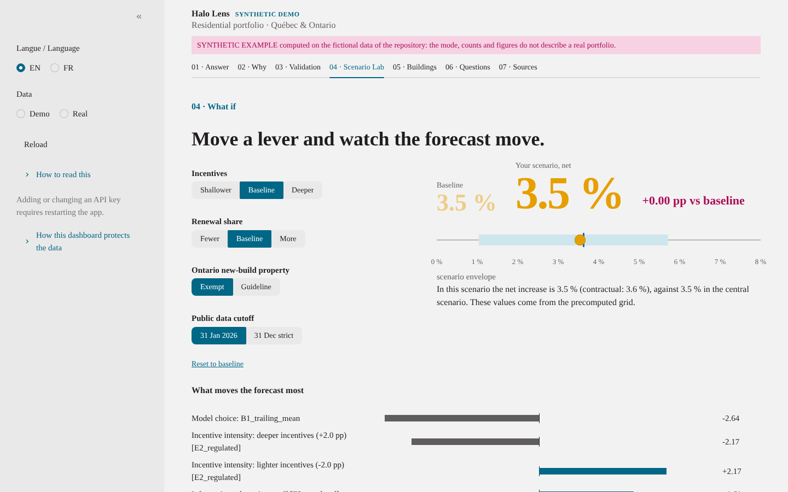
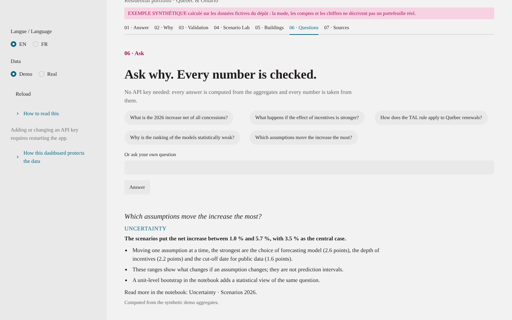

# Halo Lens: rent-growth forecast

Halo Lens (Python package `halolens`) estimates a residential portfolio's next-year rent increase from lease history and
public market data. It defines exactly what "rent increase" means, compares each unit with itself, handles incentives
explicitly, separates renewals from turnovers under each province's rules (Quebec and Ontario), and validates the method
by backtesting past years.

**No real data ships with this repository.** `data/synthetic/` holds fully invented fixtures (see
[`data/synthetic/README.md`](data/synthetic/README.md)); the demo, the tests and the default notebook build use them.
You run the pipeline on your own lease files by pointing it at a folder of your choice (below). `data/public/` holds public
statistics (Statistics Canada, CMHC, Quebec's housing tribunal, Ontario) with source URL and release date for each value.

## Method in one page

- **Headline.** Fixed-composition same-unit growth in rent net of all incentives: for each pair of consecutive leases of the
  same unit, annualized log growth; segment means (property x bedrooms x renewal/turnover) combined with weights frozen at the
  forecast date. The contractual-rent version and plain medians are always reported next to it.
- **Same-unit matching** on property code plus unit code, never on a site name, with a reason kept for every excluded pair.
- **Concessions** are reconciled to the lease they belong to; one-off credits are not treated as monthly discounts.
- **Renewals and turnovers** are separated and read under their own province's regime.
- **Forecast** from three engines (renewals, turnovers, incentives) against simple baselines, backtested with the same code
  as the real forecast and using only information available at each cutoff.
- **Uncertainty** as scenarios, sensitivities and a unit-cluster bootstrap. Scenario ranges are not prediction intervals.
- Occupancy, vacancy, absorption and rent roll cannot be measured from a lease extract and are never computed.

Full detail: [`docs/methodology.md`](docs/methodology.md), [`docs/decisions.md`](docs/decisions.md),
[`docs/references.md`](docs/references.md).

## Quick start

Requires Python 3.11, 3.12 or 3.13.

```bash
git clone https://github.com/YousefAkay/HaloLens.git
cd HaloLens
python -m venv .venv
source .venv/bin/activate        # Windows: .venv\Scripts\Activate.ps1
pip install -r requirements.txt
pre-commit install               # optional, for contributors
```

| Task | Command |
|---|---|
| Tests, full suite (synthetic data) | `pytest -q` |
| Tests, fast subset (skips the slow tests) | `pytest -o addopts="" -p no:warnings -q -m "not slow"` |
| Install the exact versions tested | `pip install -r requirements.lock.txt` (Python 3.12) |
| Build and execute the notebook (synthetic data by default; writes `analysis.ipynb`) | `python scripts/build_notebook.py` |
| Build and execute the notebook on your data (real mode) | `python scripts/build_notebook.py --real` (or `HALOLENS_DATA_MODE=real`) |
| Export aggregate results for the app | `python scripts/export_aggregates.py --synthetic` (or `--real`) |
| Launch the dashboard (synthetic demo by default) | `streamlit run app/streamlit_app.py` |
| Privacy scan of tracked files | `python scripts/leak_scan.py --tree-only` |

### Using your own data

Put the four tables (`listings.csv`, `lease_history.csv`, `concessions.csv`, `asking_history.csv`, in the column format of
`data/synthetic/`) and a `manifest.json` of their SHA-256 hashes in a folder of your choice. Point to it with `DATA_DIR` at
the top of the notebook's first cell or with the environment variable `HALOLENS_DATA_DIR`; without a setting, the notebook
reads `data/private/`. Files are verified against the manifest before they are read. Outputs computed from your data go to
`outputs/private/` (gitignored).

If your files have other names, create the optional, gitignored `config/local.yaml` (merged last) with a `data.source_files`
mapping from logical name (`listings`, `leases`, `concessions`, `asking`) to file name, for example
`data: {source_files: {leases: my_leases.csv}}`; names you leave out keep their defaults. The manifest must list the same names.

### Optional: AI features

Three features call the Claude API, always on public pages or on aggregates, never on lease rows: extracting public-source
values into `data/public/sources_draft.csv`, a source watcher (`python scripts/extract_sources.py --watch`), and the
dashboard's scenario copilot and Q&A over the aggregates, with a number guard that rejects any figure not in the results.
To enable them, copy `.env.example` to `.env` and set `ANTHROPIC_API_KEY`. The notebook and the forecast never need a key.

## Limitations and roadmap

- The loader expects the column layout of `data/synthetic/`; a column-mapping config for other layouts is planned.
- The regulation layer covers Quebec (TAL) and Ontario only.
- The notebook text is in French; the dashboard is bilingual (French and English).
- The forecasting engines do not beat the naive baseline on the synthetic demo, and three backtest years support only weak conclusions.
- Leases signed before the cutoff but starting after it are not used yet (a booked-lease signal is planned).

## Repository layout

```
notebook/sections/   one jupytext file per notebook section (assembled by scripts/build_notebook.py)
src/halolens/       analysis library: io, measure, market, incentives, forecast, evaluate, export
config/              every threshold, date and weight (no magic numbers in code)
scripts/             notebook build, source extraction, aggregate export, synthetic data, leak scan
app/                 Streamlit dashboard
data/public/         public-source extracts with release dates
data/synthetic/      invented fixtures for tests and demo
tests/               invariants and leakage tests
docs/                methodology, decisions, references, Q&A knowledge
```

## Data and privacy

- Lease data never goes into git: `data/private/`, `outputs/private/`, `models/`, `.env` and CSV files outside
  `data/public/` and `data/synthetic/` are gitignored and blocked by pre-commit hooks.
- The notebook and the dashboard show aggregates only. The dashboard reads an aggregate results file with no unit-level field.
- `scripts/leak_scan.py` scans tracked files and git history for terms on a private denylist and prints counts only.

## Reproducibility

Library versions are pinned in `requirements.txt`, seeds are in `config/core.yaml`, input files are hash-checked, and the
forecast for year y uses only information available at its cutoff (a test confirms that appending future records changes nothing).

## Sources

Public data and methodological references are listed in [`docs/references.md`](docs/references.md); per-observation provenance
is in `data/public/sources.csv`.

## AI tools used

| Tool | Use |
|---|---|
| Claude (Anthropic), chat | Planning and review of the method and tasks |
| Claude Code (Anthropic) | Implementation, tests and pre-merge review; changes were reviewed by a human |
| Claude API (Anthropic) | (1) Extracting values from public web pages into a draft source table, checked against the official pages by Claude, with a human spot-check of a named sample (not every value was checked by hand); (2) a source watcher over public pages; (3) the dashboard's scenario copilot and Q&A over aggregates, with a number guard |

No row-level lease data was sent to any API. The forecast itself is produced by the documented statistical method, not by an AI model.

## Contributors and license

See [`CONTRIBUTORS.md`](CONTRIBUTORS.md). Released under the [MIT License](LICENSE).

## Screenshots

Synthetic demo, English interface.









## History

The git history was rewritten before publication to remove confidential third-party data and tool-attribution trailers. Commit dates, messages and authorship are preserved.
